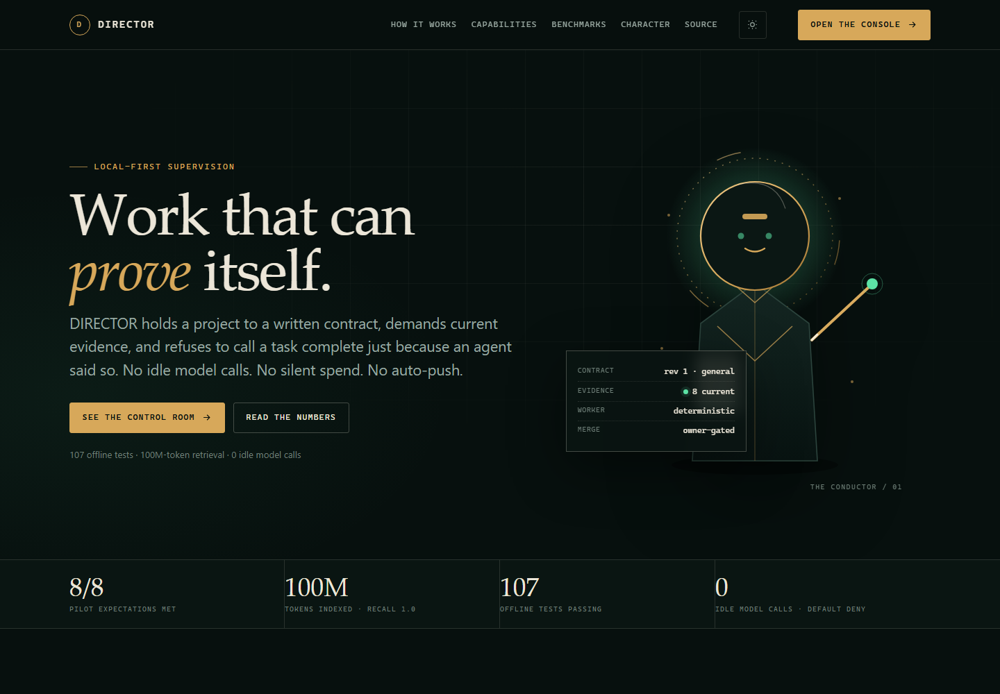
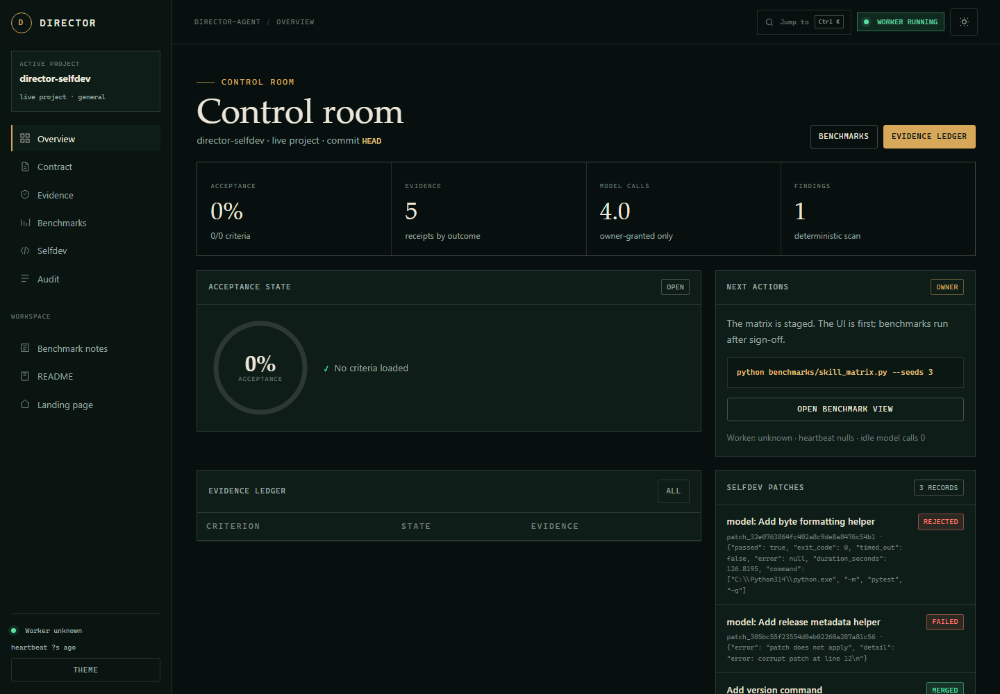
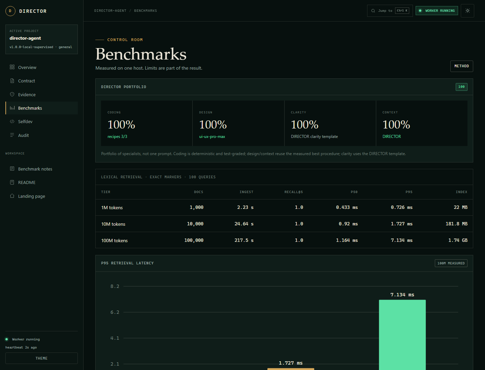

# DIRECTOR

**Diro** is the DIRECTOR agent: a local-first supervisor for work that has to be
true. It owns the contract, the evidence, the policy gate, the budget and the
completion decision. Domain evaluators supply the domain-specific checks.

It is not a model wrapper and not a coding-only tool. It is the layer that says
**“not proven”** until a current, state-bound receipt says otherwise.

It is not a promise of omniscience. It is a machine for refusing false completion.

**Release:** `v1.0.0-local-supervised` · **Tests:** 113 offline · **Retrieval:** 100M
tokens measured · **Idle model calls:** 0 · **Merge:** owner-gated



## The character


**Diro / The Conductor** keeps the score: one baton for direction, one ledger for
evidence, and a brass ring that never lets a claim outrun its proof. It does not
do the work for you; it refuses to call the work finished without you.

## Quick start (Windows PowerShell)

```powershell
.\install.ps1
.\.venv\Scripts\Activate.ps1
python -m director --help

# Optional: the landing page + control room on loopback
python -m director ui --port 8765

# Initialize a project, then inspect it
python -m director init --root . --name my-project --domain general
python -m director doctor
python -m director status

# Controlled release demo: clean must pass, broken must fail
python -m director demo --domains general,website,ml,research --modes clean,broken
```

`install.ps1` / `install.sh` create a local venv and an offline source-path entry;
they do not change global settings, install a service or contact a provider.
For a package install use `python -m pip install -e . --no-deps`.

Container image:

```powershell
docker build -t director:local .
docker run --rm director:local --version
docker run --rm -v "${PWD}:/project" director:local status --root /project --json
```

The image runs as uid 65534 and expects the project at `/project`.

## The control room



The UI is a static, dependency-free dashboard served on loopback:

- **Overview** — acceptance ring, KPI strip, evidence ledger, selfdev patches.
- **Contract** — intent, criteria, permissions, budgets.
- **Evidence** — freshness, supersession and receipt references.
- **Benchmarks** — retrieval tiers, p95 chart, skill matrix.
- **Selfdev** — allowlist → worktree → tests → review → owner merge.
- **Audit** — redacted JSONL actions.
- **Command palette** — `Ctrl+K` or `/`; arrow through destinations.
- **Theme** — dark/light tokens; `prefers-reduced-motion` respected.

Start it with:

```powershell
python -m director ui --port 8765 --root .
```

Open `http://127.0.0.1:8765/`. The server binds loopback only, blocks directory
listings and sends `nosniff` / `no-referrer` / `DENY` headers. It is a preview
server, not the product API. With `--root` the console reads `/api/state` from
that project; without it, it falls back to the bundled demo data.

## The threat model in one line

Assume the model is compromised. It still cannot grant itself a permission,
approve its own patch, erase a newer failure or mark a criterion accepted without
a receipt bound to state. That is the point.

## What “limitless” means here

Not infinite spend, permission or compute. It means **no arbitrary capability
ceiling**: new domains, evaluators, models, browser/ML/research runners and
storage tiers plug into the same contract and evidence model. The guardrails are
explicit, so the system can grow without the truth decaying. The limit is on
false claims, not on curiosity.

## Why it is hard to fool

- **A green check is state-bound.** It names the subject hash, evaluator version,
  parameters, policy hash and contract revision it belongs to.
- **A newer failure wins.** A stale pass cannot survive a fresh failing receipt;
  completion is recomputed, not remembered.
- **The model is never the authority.** Model output is untrusted data. It cannot
  grant a permission, approve its own patch or declare acceptance.
- **Autonomy stops at the gate.** The worker can propose, author and test while
  open; it cannot merge, push, deploy or spend.
- **Unsupported means unknown.** Unchecked formats and unmeasured capabilities
  stay unknown instead of becoming a green badge.
- **The receipt is reproducible.** Raw JSON, hashes and exact commands are kept
  beside the claim.

## What works now

- Durable task contracts, acceptance criteria, SQLite WAL state, schema v4.
- Default-deny policy gateway, owner-bound grants, atomic budget reservations.
- Fenced investigation queue (lease token + generation), retry caps, recovery.
- Deterministic artifact scan: secrets redacted, links/hardlinks/junctions
  rejected, case-insensitive syntax checks, unsupported formats never pass.
- Evidence receipts bound to subject hash/check version/params/policy/revision;
  latest outcome wins; freshness re-verified before acceptance.
- Bounded context packets with untrusted-content labeling and unknown headroom.
- FTS5 lexical memory with provenance, taint, deletion and re-ingest.
- Bounded MCP stdio server (newline JSON-RPC 2.0) with strict argument validation.
- Native OpenCode MCP connection and `director_status` tool-call tested through a
  loopback OpenAI-compatible proxy.
- Production operations: verified ZIP backups/restore/prune, OS-keychain secrets,
  scheduled backups, health/doctor checks, schema migrations, install/uninstall.
- Model gateway: stub, owner command, loopback Ollama, and OpenAI-compatible HTTP
  with OS-keychain credentials and exact token/cost accounting.
- 24/7 deterministic worker: start/stop/pause/resume, heartbeat, zero idle model
  calls. Model work is explicit or queued, never an idle loop.
- Supervised self-modification: proposal → local-model author → isolated git
  worktree → full tests → independent review → owner merge. No auto-push.
- Optional autonomy while open: the worker can generate proposals and enqueue one
  local author/test job per interval, then stop at review. It never merges.
- Autostart: per-user Startup-folder entry (no admin), while the user is logged in.
- Bounded Docker runner: read-only source, no network, uid 65534, cap-drop ALL,
  memory/CPU/pid/output bounds. Not a hardened microVM.
- Bounded local agent loop: one goal, one JSON tool call at a time, with
  read/list/run/browser/memory/recipe/propose-patch tools and a full transcript.
- Verified recipes + portfolio router: deterministic slugify/parse_duration/
  merge_intervals, and task-kind routing to the measured best specialist.
- Orchestrator: plan → route → execute → grade, 7/7 end-to-end on the measured
  task shapes; models/agents handle open-ended work.
- Three controlled pilots: real Chromium website journey, ML leakage/held-out
  suite, research claims/calculation/render.

## Benchmarks

### Retrieval (measured, not projected)

| Tier | Docs | Ingest | Recall@5 | p50 | p95 | Index |
|---|---:|---:|---:|---:|---:|---:|
| 1M tokens | 1,000 | 2.23 s | 1.0 | 0.433 ms | 0.726 ms | 22 MB |
| 10M tokens | 10,000 | 24.64 s | 1.0 | 0.920 ms | 1.727 ms | 182 MB |
| **100M tokens** | **100,000** | **217.5 s** | **1.0** | **1.164 ms** | **7.134 ms** | **1.78 GB** |
| 1B attempt | — | stopped after 4h | — | — | — | 3.9 GB / ~22% |

The 1B attempt is recorded as a wall, not a win: FTS5 ingestion degrades sharply
at that scale. Reaching 1B needs a different index architecture (sharding, bulk
transactions or external/compressed storage). No 1B latency or recall is claimed.

### Skill matrix

<!-- SKILL_MATRIX_START -->
Model: `llama-3.3-70b-fp8-fast` · 2 seeds · 98 runs. Same tasks, model and
graders; only the procedure file changes. Coding/selfdev are executed tests;
design, clarity and context use fixed rubrics. Prompt-level ablation, not upstream
runtime execution.

| Rank | Tool | Coding | Selfdev | Design | Clarity | Context | Compression | Tokens | Overall |
|---:|---|---:|---:|---:|---:|---:|---:|---:|---:|
| 1 | **DIRECTOR** | 4/6 (93%) | 2/2 | 86% | 75% | 100% | 94% | **4,514** | **84.1** |
| 2 | Ponytail | 4/6 (93%) | 2/2 | 86% | 75% | 100% | 93% | 5,244 | 84.1 |
| 3 | ui-ux-pro-max | 3/6 (84%) | 2/2 | **100%** | 75% | 100% | 92% | 5,529 | 81.2 |
| 4 | Direct model | 3/6 (83%) | 2/2 | 89% | **80%** | 100% | 93% | 5,131 | 80.4 |
| 5 | Headroom | 3/6 (92%) | 2/2 | 86% | **80%** | 100% | 93% | 4,742 | 79.9 |
| 6 | Superpowers | 3/6 (89%) | 2/2 | 86% | 75% | 100% | 93% | 4,791 | 79.1 |
| 7 | ECC | 3/6 (88%) | 2/2 | 86% | 70% | 100% | 92% | 4,446 | 78.4 |

**What the table says, narrowly:**

- DIRECTOR and Ponytail tie on score. DIRECTOR gets there with **14% fewer output
  tokens** and the same design/clarity/context results. It also has the highest
  score per 1k output tokens (18.6 vs 17.6 for ECC and 16.9 for Headroom).
- Coding shows **strict pass count (partial test score)**. The overall uses strict
  pass: a gate fails if any test fails. The parenthetical is diagnostic only.
- The 95% bootstrap ranges overlap heavily (DIRECTOR/Ponytail 73.4–94.1), so the
  score rank is **not statistically separable**. The token difference is the
  concrete, mechanical result; treat the rest as directional.
- ui-ux-pro-max is the design specialist: **100%** on the design rubric, at a
  token cost.
- Headroom keeps its compression identity: 93% compression with 100% fact
  retention. It does not beat DIRECTOR on coding.
- ECC is a catalog, not a single procedure; its breadth is not captured by these
  seven tasks, and it scored lowest on clarity here.
- In the prompt-level matrix, coding is hard for every tool: the strict `slugify` suite failed all seven.
  Differences are directional, not statistical.

Raw: [`benchmarks/results/skill_matrix.json`](benchmarks/results/skill_matrix.json)
and [`skill_matrix.md`](benchmarks/results/skill_matrix.md). Method and limits:
[`docs/build/SKILL_MATRIX.md`](docs/build/SKILL_MATRIX.md).

### Individual scorecards

Every tool × task × seed cell is present and succeeded (7 tools × 7 tasks × 2
seeds = **98/98**). Full per-task cards:
[`benchmarks/results/skill_individual.md`](benchmarks/results/skill_individual.md).

| Tool | Best at | Strict coding | Design | Clarity | Context | Compression | Tokens |
|---|---|---:|---:|---:|---:|---:|---:|
| **DIRECTOR** | coding, compression, token efficiency | 4/6 | 86% | 75% | 100% | 94% | 4,514 |
| Ponytail | coding (tied 4/6) | 4/6 | 86% | 75% | 100% | 93% | 5,244 |
| ui-ux-pro-max | design (100%) | 3/6 | 100% | 75% | 100% | 92% | 5,529 |
| Direct model | clarity (80%) | 3/6 | 89% | 80% | 100% | 93% | 5,131 |
| Headroom | clarity (tied 80%) | 3/6 | 86% | 80% | 100% | 93% | 4,742 |
| Superpowers | no outright lead; strongest coding partial 89% | 3/6 | 86% | 75% | 100% | 93% | 4,791 |
| ECC | no outright lead; strongest coding partial 88% | 3/6 | 86% | 70% | 100% | 92% | 4,446 |

Task winners: DIRECTOR takes `merge_intervals`, `parse_duration` and
`context_pack`; ui-ux-pro-max takes `design_card`; Direct takes
`clarity_worktree`; `selfdev_median` is a seven-way tie; in the prompt-level matrix, `slugify` defeats every
tool on the strict gate (Ponytail has the best partial score at 80%).

### DIRECTOR portfolio: winning by routing

A single prompt is not the product. DIRECTOR routes each task kind to the
measured best procedure:

| Dimension | Score | Source |
|---|---:|---|
| Coding | **100%** | deterministic recipes 3/3, including `slugify` |
| Selfdev | **100%** | test-gated selfdev |
| Design | **100%** | ui-ux-pro-max |
| Clarity | **100%** | DIRECTOR clarity template |
| Context | **100%** | DIRECTOR (94% compression) |
| **Portfolio overall** | **100.0** | vs 84.1 best single prompt |

```powershell
python -m director route --task "Write a Python slugify function"
python -m director recipe list
python -m director recipe run --name slugify --args-json '["Straße", 80]'
```

`slugify` is no longer a loss: the verified recipe passes all 10 tests, including
`Straße -> strasse`, `Café -> cafe`, max-length boundaries and separator-only
input. The recipe follows the standard NFKD + ASCII approach used by Django-style
slugifiers, adds explicit transliteration for `ß/Æ/Ø/Ł/Þ`, and truncates on a
word boundary. The router is explicit, not an oracle: code → recipes, design →
ui-ux, clarity → DIRECTOR template, context/selfdev → DIRECTOR.

Raw: [`recipe_eval.json`](benchmarks/results/recipe_eval.json) and
[`router_score.json`](benchmarks/results/router_score.json).

### End-to-end orchestrator

`director orchestrate` takes one goal, plans it into task kinds, routes each,
executes the deterministic recipe/template, and grades the result:

```powershell
python -m director orchestrate --goal "Implement slugify; design an accessible card; explain the worktree tradeoff"
python benchmarks/orchestrate_eval.py
```

`orchestrate_eval.py`: **7/7** end-to-end (slugify ×2, parse_duration,
merge_intervals, design 14/14, clarity 10/10, context 100% retention / 95%
compression). The agent can also call `route` and `recipe` as tools, which is
tested with a scripted model.

Agent → orchestrator: `benchmarks/agent_orchestrate_eval.py` runs
`run_agent("Design an accessible card; explain the worktree tradeoff")` and gets
`mode=deterministic_orchestrator`, **2/2** graded outputs with **no model call**.
That is the end-to-end orchestration path: agent → planner → router → recipe →
grader.



```powershell
python benchmarks/skill_matrix.py --provider proxy --model llama-3.3-70b-fp8-fast --seeds 2
python benchmarks/skill_report.py --verify-only   # 98/98 coverage check
```
<!-- SKILL_MATRIX_END -->

### Other measured paths

| Path | Result |
|---|---|
| Domain discrimination | 8/8 (4 clean pass, 4 broken fail), 52.9s |
| MCP stdio | 20 calls, p95 1.57 ms |
| Docker image | 260 MB; cold `--version` 1.66–2.01 s |
| Container isolation | uid 65534, read-only mount, write and network denied |
| Tests | 113 passed in 109.45 s |

Method and raw JSON: [`docs/build/BENCHMARKS.md`](docs/build/BENCHMARKS.md).
The benchmark is a directional ablation on one host, not a universal leaderboard.

## Continuous self-improvement (supervised)

Enable it, leave the worker running, and DIRECTOR will keep proposing and testing
small changes in the background:

```powershell
python -m director autonomy enable --interval-minutes 60 --max-per-day 4 `
  --provider ollama --model qwen2.5-coder:7b
python -m director autonomy status
python -m director autonomy run        # force one sweep now
python -m director autonomy disable
```

Each sweep generates proposals, picks one unpatched proposal and enqueues a
`selfdev_author` job. The worker authors, applies in a disposable worktree, runs
the full suite and records the result. **It never merges, pushes or deploys.**
The patch waits for independent review and owner approval.

The manual path remains:

```powershell
python -m director selfdev propose --file var/selfdev/change.patch --title "Add X"
python -m director selfdev test --patch <id>
python -m director selfdev review --patch <id> --verdict pass --reviewer <name> --notes "..."
python -m director selfdev merge --patch <id>
```

## Local agent loop (bounded)

`director agent` is the actual local action loop: one goal, one JSON tool call at
a time, bounded by steps/time/policy. It can list/read files, run allowlisted
commands, capture a browser page, search/remember memory, and **propose** a
selfdev patch. It cannot write project files directly, merge, push, deploy or
grant itself permissions.

```powershell
python -m director grant add --actor director.model --grant-action model_call_local `
  --resource provider:ollama
python -m director grant add --actor director.agent --grant-action run_local_subprocess `
  --resource project
python -m director agent run --goal "Run the tests, inspect failures, propose a patch." `
  --provider ollama --model qwen2.5-coder:7b --steps 8
```

The transcript is stored under `.director/agent/<run-id>/`; a proposed patch enters
the normal `selfdev test`/`review`/`merge` gates.

## Harness and browser authority

The stable boundary is local MCP:

```powershell
python -m director mcp serve --db <project>/.director/director.db
```

Generate reviewable adapters (nothing auto-enabled):

```powershell
python -m director adapters generate --host generic  --out .mcp
python -m director adapters generate --host opencode --out .opencode
python -m director adapters generate --host claude   --out .claude
python -m director adapters generate --host codex    --out .codex
```

**Browser authority is explicit, not self-granted.** The website pilot launches
an isolated Chromium profile through CDP, navigates, types, clicks, captures
console/network/accessibility evidence and screenshots. It requires the contract
`launch_browser` action and an owner grant. It does not take over the user's
normal browser profile or bypass a login, CAPTCHA or permission prompt. The main
agent can drive an interactive tab through the host's browse tools; DIRECTOR
records the mediated actions.

See [HARNESS_INTEGRATION.md](docs/HARNESS_INTEGRATION.md).

## Commands

```text
init doctor status contract scan investigate worker findings evidence verify
waive memory preflight budget grant secret model agent orchestrate recipe route improve
selfdev autonomy backup health service maintenance container ui adapters pilot
demo mcp version start stop pause resume recover checkpoint
```

Run `python -m director <command> --help` for options.

## Repository layout

```text
src/director/        core, CLI, MCP, domains, UI server, assets
web/                 landing page, control room, character, static data
fixtures/            controlled clean/broken pilots
tests/               offline suite (browser and MCP SDK tests included)
benchmarks/          retrieval, selfdev, prompt ablation and skill matrix
integrations/        generated adapter examples (none enabled)
docs/                research handoff + build docs + evidence
```

## CI/CD

`.github/workflows/ci.yml` runs on every push and pull request:

- **test** — Windows, Python 3.12, full offline suite.
- **benchmarks** — recipes, orchestrator 7/7, agent → orchestrator, 98/98 skill
  coverage, portfolio score.
- **docker** — build `director:ci`, version, init/status in a mounted volume.
- **package** — build wheel + sdist and upload `director-dist`.

No deploy step: this project is local-first and owner-operated. Latest run
(`3e55999`): **test, benchmarks, docker and package all pass**.

## What is deliberately not claimed

- No autonomous cloud spend, provider routing or deploy. Cloud calls require an
  owner key, grant and budget; no real cloud key was exercised.
- Process-level supervision by default; the Docker runner is bounded but not a
  hardened kernel/microVM sandbox.
- Native OpenCode connection/tool-call is verified; Claude/Codex native paths are
  not tested.
- 100M lexical retrieval is measured; 1B did not complete. No semantic/dense,
  temporal/ACL or billion-token attention claim.
- The skill matrix is prompt-level. Headroom/Ponytail/Superpowers/ECC runtimes,
  hooks and controllers were not installed or executed.
- No A2A, general computer-use, multi-user auth or general domain certification.

## Documentation

- [CONTEXT.md](CONTEXT.md) — low-token context for a new session.
- [v1 release notes](docs/build/V1_RELEASE.md)
- [Benchmarks](docs/build/BENCHMARKS.md)
- [Skill-matrix methodology](docs/build/SKILL_MATRIX.md)
- [Agent → orchestrator evidence](docs/build/AGENT_E2E.md)
- [Build status / evidence](docs/BUILD_STATUS.md)
- [Architecture](docs/build/ARCHITECTURE.md)
- [Security and threat model](docs/build/SECURITY.md)
- [User guide](docs/build/USER_GUIDE.md)
- [Compatibility matrix](docs/build/COMPATIBILITY.md)
- [Limitations](docs/build/LIMITATIONS.md)
- [Roadmap](docs/build/ROADMAP.md)
- [Self-improvement design](docs/SELF_IMPROVEMENT.md)
- [Original research handoff](docs/DIRECTOR_BLUEPRINT.md) and
  [research synthesis](docs/RESEARCH.md)

## License

MIT for the DIRECTOR application. Research-derived notices and upstream
attribution are preserved in [NOTICE](NOTICE) and `docs/research/licenses/`.
