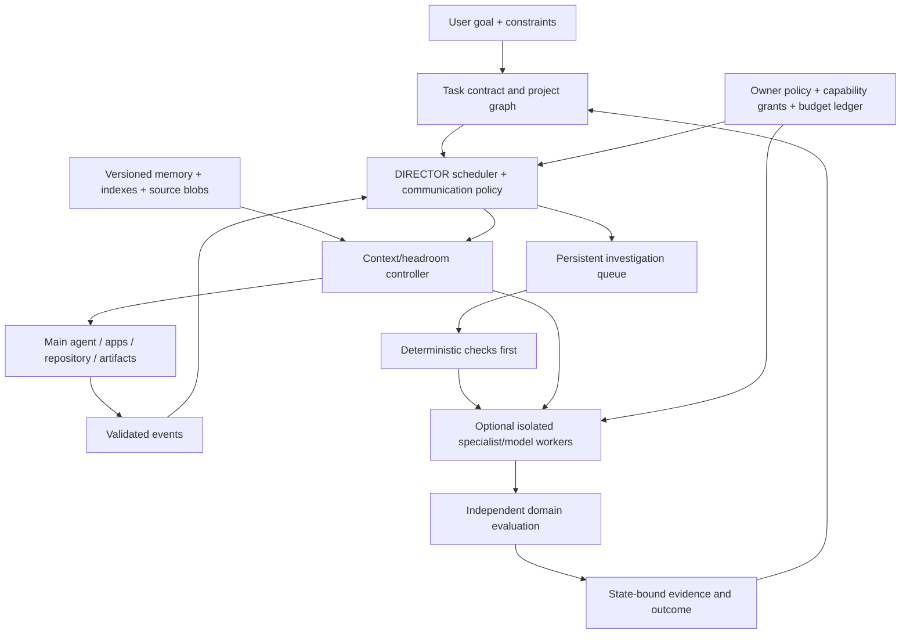

# DIRECTOR — universal project supervision blueprint

Research/design date: **2026-11-23**. Current assignment: **research and a complete future build prompt only**. No further product implementation is authorized in this research session. This document supersedes the earlier coding-focused PRODUCT_SPEC.md and implementation plan.

## What DIRECTOR should be

DIRECTOR is a local-first, persistent autonomous supervisor that helps a person and their main agent take a project from intent to an explicitly verified outcome. It should work across supported domains: websites, apps, model development, data pipelines, research, writing, documents, spreadsheets, presentations, design, media and tool-assisted operations. New domains arrive through capabilities and evaluators rather than a rewrite of the core.

Its central job is to continually answer: **What is the user trying to achieve? What is the most valuable next action? What evidence would show the result is good enough? What is still uncertain?** It improves the work and the builder's efficiency, independently investigates important gaps, and carries state across sessions and failures.

“Anything” describes an extensible goal, not a verified compatibility list. “Finest” means fit for the user's purpose and constraints, not endless additions. “Until the end” means reaching the owner's acceptance criteria or reporting a real block, failure, cancellation or exhausted budget. No architecture can promise perfect performance on arbitrary future tasks, prove subjective quality mechanically, or keep working without a running host and resources.

## Why the requested combination needs a new core

**DIRECTOR + Headroom + Ponytail + Superpowers + ECC + massive virtual context** combines different layers:

- DIRECTOR owns intent, authority, durable state, orchestration, evaluation and the communication policy.
- Headroom offers actual content transformation and recovery mechanisms, with important cache, fidelity and network-default tradeoffs.
- Ponytail supplies a minimum-sufficient-change/reuse rubric. It must not delete necessary validation, evidence or quality work.
- Superpowers supplies development workflows and helper artifacts. Its approval/TDD/review stages apply where appropriate to engineering; other domains need different procedures.
- ECC offers a large capability catalog and practical executable hooks/runtime components. Select narrow capabilities; do not install competing controllers and memory systems wholesale.
- Virtual context connects durable knowledge to bounded working contexts through retrieval, provenance, versioning and evaluated compaction.

These upstream projects are not parts of a single existing DIRECTOR product. Full inventories and source traces are in research/. Current decisions are proposals, not claims of runtime integration.

## Core behaviors, regardless of domain

### 1. Understand and contract the actual objective

Capture the original request, desired user outcome, deliverables, constraints, non-goals, acceptance criteria, timeline, budget, permissions, evidence requirements and unresolved assumptions. Preserve changes of intent. Ask one material question when guessing would waste real effort; otherwise state a reasonable assumption and continue within authorization.

For vague quality language, propose measurable dimensions and get the owner's priorities into the contract. For example, a model's accuracy alone does not establish deployment readiness; a beautiful website that cannot complete the user's purchase flow is incomplete.

### 2. Analyze the existing project before directing changes

Build a scoped view of artifacts, requirements, decisions, tests/evaluations, environments, dependencies, users and current gaps. Distinguish missing evidence from demonstrated failure. Follow important claims to their owning source; do not rely on a stale summary. Look for existing components and simpler solutions before adding tools or abstractions.

Produce a prioritized assessment covering correctness, completeness, usability, security/privacy, performance/resources, maintainability/reproducibility, accessibility where relevant, factual quality and operational readiness. Every dimension needs a domain-specific interpretation and an explicit confidence level.

### 3. Improve both the main agent and DIRECTOR

Provide focused preflight packets, targeted skills, the right tools, cheap discriminating checks and bounded next actions. Allocate models and reasoning by complexity/risk/expected value. Keep builder and investigator contexts separate. Batch independent work; serialize dependencies and shared writes. Do not duplicate planning, review, permission or memory-authority loops across plugins.

### 4. Investigate proactively without inventing defects

Triggers include artifact edits, failing evaluations, dependency changes, external requirements becoming stale, repeated errors, resource drift and unverified acceptance criteria. Maintain a persistent hypothesis queue with impact, probability, evidence, estimated cost, owner, scope, next check and stopping rule. Idle opportunity work should improve the user's current goal; speculative features need a clear benefit and stay within configured resources.

An investigation may conclude disproven, inconclusive, blocked or verified. A prediction is never a finding merely because a model sounds confident. Use the cheapest safe test that distinguishes the hypothesis.

### 5. Finish with independent evidence

Inspect the real final artifact/environment, not just the builder's narrative. Record exact inputs, tool/check versions, source/dataset/artifact hashes, parameters, environment, timestamp, raw evidence references, outcome and limitations. Bind evidence to the state it tested; invalidate it when relevant state changes. Do not let an agent mark its own unsupported assertion verified.

Completion requires every mandatory acceptance criterion to have appropriate current evidence, or the owner to explicitly waive it with a recorded reason. A parser pass, closed dependency issue, plausible screenshot, high training score or successful tool exit cannot stand in for the actual outcome. Unexecuted checks remain unverified.

## Domain profiles: same core, different evidence

| Domain | What DIRECTOR must examine | Appropriate evidence | Common false success |
|---|---|---|---|
| Website/app | Real user journeys, states, content, mobile layout, accessibility, auth, data, performance, deployment | Unit/integration/browser tests, keyboard/screen-reader checks, visual review, measured performance and production smoke within authorization | Build passes but key flow fails; screenshot of one page treated as full UX validation |
| ML/model development | Objective, dataset rights/provenance, split integrity, leakage, baseline, metric choice, error slices, reproducibility, compute/inference cost | Held-out tests, training/eval manifests, seed/environment/checkpoint lineage, uncertainty, baseline comparison, deployment checks | Training accuracy or a cherry-picked sample treated as model success |
| Data/analytics | Schema, units, joins, missingness, lineage, privacy, invariants, statistical assumptions | Known-answer queries, reconciliation, data-quality checks, sampling, sensitivity/error analysis | Successful pipeline run with wrong rows or units |
| Research | Exact question, date sensitivity, primary sources, disagreements, inference versus fact, coverage | Source-to-claim links, direct document inspection, reproducible calculations, uncertainty and date notes | Confident uncited prose or stale evidence |
| Writing/documents | Audience, intent, voice, factual claims, structure, source fidelity, formatting | Requirements review, factual verification, rendered page review, editing feedback | A saved file whose content is wrong or unreadable |
| Spreadsheets | Input provenance, formulas, units, references, edge cases, presentation | Formula checks, independent totals, scenarios, recalculation and visual inspection | Values visible while formulas or references are broken |
| Design/media | Brief, message, originality, accessibility, fidelity, dimensions, asset rights, export quality | Human/visual review, format/asset checks, target-device render, clearly labeled subjective judgment | Export success mistaken for design quality |
| Operations/computer-use | Desired external state, authority, reversibility, account identity, side effects | Supported API/DOM/UI evidence, receipts, controlled retries, confirmation of external result | Button clicked but operation not completed, or duplicate action after recovery |
| New/unknown domain | Available tools, competence, constraints, evaluator feasibility | Explicit capability check, calibrated specialist review or owner confirmation | Claiming universal competence without a working adapter/evaluator |

Profiles are versioned capability bundles: activation, allowed inputs, tools, permissions, risk, evidence schema, budgets, quality rubric, evaluators and known limits. Automatic domain suggestions are advisory; user intent controls selection. Multiple profiles can apply to one project, such as a model served through a website.

## Architecture and ownership

Use one event dispatcher, scheduler, policy gate, budget ledger, memory authority and completion authority. Workflow plugins may propose work and return evidence; they cannot expand permissions, spend money or self-certify completion. Prefer a supported connector/API over fragile computer-use; fall back to browser/desktop only where needed.

**Enforcement boundary:** DIRECTOR can enforce this for workers and effects that actually pass through its gateway. An external main agent retains its own host controls and may have tools DIRECTOR cannot intercept. Hooks/context guidance alone are advisory and are not a complete security boundary. Claim enforced coverage only for a tested host/action path that cannot bypass mediation; otherwise report observed/advisory coverage and its blind spots.

Core persisted entities: Project, Goal, Requirement, Artifact, TaskContract, TaskRevision, Event, Investigation, Hypothesis, CapabilityGrant, Approval, WorkerLease, BudgetReservation, SourceVersion, MemoryRecord, GraphEdge, Evidence, EvaluationRun, Finding, Notification, Checkpoint and Handoff.

Typed graph edges include depends_on, implements, derived_from, evaluated_by, contradicts, supersedes and related_to. A relevance edge does not mean a requirement passed. Retain graph/source version and ownership. Distinguish user-confirmed facts, observed evidence, inferred relationships and model hypotheses.

## Efficiency and context system

An idle service makes no model calls. Native events and scheduled owner-approved freshness checks create work; deterministic deduplication, content hashes and changed-artifact analysis handle most events. Use a bounded queue with backpressure, priorities, expiring leases, unique claim tokens and generations. Coalesce event bursts. A stale worker cannot publish derived state after lease loss or a newer generation. Crashes must not repeat external effects: use action keys plus before/after state checks; record uncertainty where exactly-once execution is impossible.

Priority proposal: expected user impact × likelihood × urgency × confidence / estimated total cost, constrained by dependencies and fairness. Treat this as a tunable heuristic, not a scientific quantity. Reserve a small owner-set fraction of effort for high-impact unknowns; do not starve mandatory acceptance work.

For every provider call, budget the complete serialized request: system/developer instructions, conversation, user task, tools, evidence, attachments and provider envelope, plus output/reasoning/tool-return/safety reserves. Hooks normally cannot know the builder's true existing context: return a packet cap and unknown overall headroom unless supplied reliable host telemetry. Use provider token counting when supported; otherwise label estimates and include margin.

Retrieval progresses from small overview to relevant chunks, exact source spans and related evidence. Keep stable prefixes stable; count cache-write/read tariffs and compression/recovery overhead. Never compress away the original user goal, permissions, required evidence or active failure. Retain originals and traceable references for any lossy summary. Headroom lossless/CCR modes need separate acceptance tests.

Model routing should use task complexity, uncertainty, stakes, available context, latency, local resources and a hard budget. Local inference has electricity/RAM/latency costs even with zero API charge. Parallel agents must justify extra contexts; default to one active controller and a small number of independent specialists with scoped handoffs. Stop escalating when expected benefit is low or resources are exhausted.

## Massive external memory, honestly

Goal: index billions of tokens **over time** across owner-approved project artifacts, documents, history and evidence. Active model attention remains bounded. Store source blobs separately from indexes, graph facts, episodic history, confirmed decisions, summaries and investigation state.

Use content hashes and version manifests; lexical search first, dense retrieval where useful, graph/time filters, rank fusion and bounded reranking. Apply ownership/ACL checks before retrieval and before output. Keep original provenance, confidence, valid-time, ingest-time and supersession. Handle contradictions and explicit forgetting/deletion, including indexes, embeddings, summaries, backups and remote replicas. Extract documents in isolated parsers; archive/model/media files require format-specific metadata and sidecar manifests rather than dumping binary bytes into a prompt.

Planning arithmetic at assumed 4 bytes/token: 1B tokens ≈4 GB raw text. At 800-token chunks with 10% overlap: ≈1.39M chunks. At 768 float32 dimensions: ≈4.27 GB vectors alone, excluding ANN, metadata, text overlap, copies and caches. These ratios are assumptions, not measurements. An 8K-token evidence packet covers only 0.0008% of 1B tokens. No retrieval method guarantees finding every relevant fact.

Evaluate 1M →10M →100M →1B token tiers. Measure real token/byte counts, ingestion/reindex throughput, disk/RAM, recall@k, MRR, temporal accuracy, abstention, contradiction handling, deletion effectiveness, source freshness, ACL leakage and p50/p95 latency. Use domain tasks and adversarial queries, not only needle lookup. Recursive document exploration is a research option requiring call-depth, cost and code-execution bounds.

## Security and reliability

Local-only by default, narrow per-project roots and data classes, external models/network opt-in. Credentials stay in an OS keychain. Prompt/tool/retrieved content is data, not authority. Use capability grants that bind actor, tool, path/account/host, action, limits, expiration and task revision. Money and consequential effects need action-bound approval unless an explicit capped standing policy covers them; tainted data cannot authorize them.

Isolate code/tests/training/extraction/browser activity in an actual OS/container/VM boundary with read-only inputs where possible, narrow writable outputs, network restrictions, process-tree termination and CPU/RAM/GPU/time/output quotas. A worktree is not a security boundary. Validate arguments without shell interpolation. Bound input frames before parsing and outputs before allocation; reject unknown arguments and sanitize errors. Test links including hardlinks, Windows junctions, traversal, race conditions, malicious archives, dependency scripts, prompt injection and cross-project leaks.

Watching a project is not proof every event was delivered. Register watchers before reconciliation; buffer during scan, reconcile on restart/detectable overflow and expose degraded/stale monitoring. Evidence rechecks current hashes/policy; source changes during or after verification invalidate the result. Future service installers need explicit start/stop/pause, health, log retention, uninstall and rollback. No claim of 24/7 work after host shutdown or budget exhaustion.

## Minimal interruption, explicit lifecycle

States: proposed, ready, running, waiting_for_evidence, budget_paused, blocked, failed, cancelled and completed. Only completed means mandatory acceptance evidence is satisfied. Limit retries and loop depth; checkpoint on resource pressure. Surface blockers promptly, batch ordinary findings, suppress duplicates and honor quiet hours. Escalate to the owner for a missing decision, needed authorization, conflicting objectives or unusable credentials; do not repeatedly ask for permissions already granted.

At exhaustion: stop starting costly work, retain budgets/reservations and unresolved evidence, checkpoint, notify once and continue only deterministic monitoring within policy. A new context window does not replenish money or API quota. A checkpoint carries the contract revision, progress, source/evidence pointers, pending hypotheses, authority, remaining budget, next action and reason for handoff.

## Build order and release gates

1. **Research freeze and contracts:** verify standards, pins, licenses, overlap map and domain evidence schemas. Define an honest compatibility matrix and evaluation corpus.
2. **M0 common substrate:** local installer/CLI, durable events, contracts, queue, policy, evidence ledger, context packets, zero-model idle and recovery. No broad autonomy.
3. **M1 three vertical pilots:** website, ML experiment and research/document workflow. Same core, separate evaluators. Prove user outcomes across these distinct domains before claiming broader support.
4. **M2 supervised reasoning:** opt-in providers/local models, exact usage/cost reservations, routing, safe model proposals, independent checks, calibrated notifications.
5. **M3 selected composition:** measured Headroom adapter, selected Superpowers/Ponytail/ECC procedures, generated adapters and real Claude/Codex tests. One authority per workflow stage; upstream licenses and data/network behavior reviewed.
6. **M4 scale and more domains:** hybrid/temporal graph memory, tiered scale benchmarks, additional validated domain bundles, authenticated A2A and isolated computer-use where justified.

Default future build target: **v0.1-supervised-three-domain = M0 + M1**. Later milestones are design/roadmap deliverables for that release. M1 requires a narrow isolated execution path for its controlled website/CPU-ML/document fixtures, scoped grants and typed state-bound evidence import/independent validation. It may use the main agent's supervised reasoning before DIRECTOR has autonomous provider routing. Unavailable isolation/evaluation makes a pilot blocked, not completed. General autonomous tools and broad host/upstream integration remain later work.

Proposed evidence gate: no critical permission/scope/secret leaks in adversarial fixtures; no unsupported completion on seeded failures; deterministic idle makes zero provider calls; all output/input/context/cost bounds hold under adversarial load; crash/restart tests preserve work and avoid duplicate consequences. Performance/quality targets need baselines before numeric release thresholds are set.

## Cheap tests of the product thesis

| Risk | Cheapest discriminating test | What would change the plan |
|---|---|---|
| Overhead exceeds benefit | Paired baseline versus DIRECTOR on matched tasks, same model/resources; count accepted outcomes, total cost/time and interruptions | Narrow or disable guidance that does not improve cost per accepted outcome |
| Findings are generic or wrong | Seed defects plus clean decoys; blind assessment by practitioners in each pilot domain | Stay advisory; improve evaluators before enabling proactive alerts |
| Universal design becomes a bloated framework | Run three pilot domains on the same small core; record core changes each needs | Split domain logic if core grows domain conditionals; remove unused abstractions |
| Memory misses decisive facts | Retrieval, update, contradiction, abstention and deletion tasks at increasing scale | Adjust retrieval/data model before expanding capacity claims |
| Upstream combination conflicts | Ablations for each component and duplicate-hook/approval-loop tests | Select a smaller bundle or choose one procedure owner |

The durable advantage must come from measured project understanding and reliable outcomes at low overhead. A larger collection of prompts is not that evidence.
